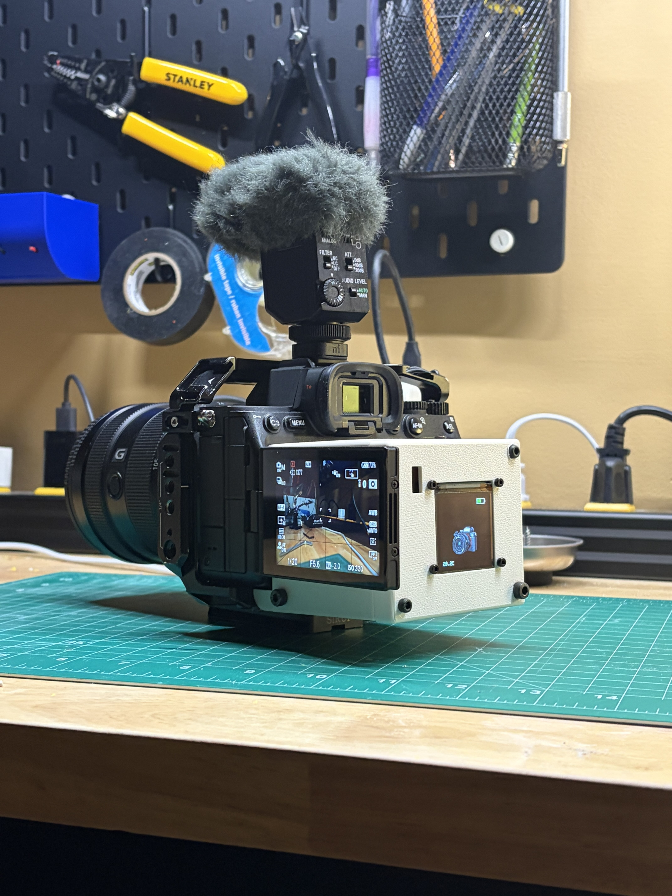
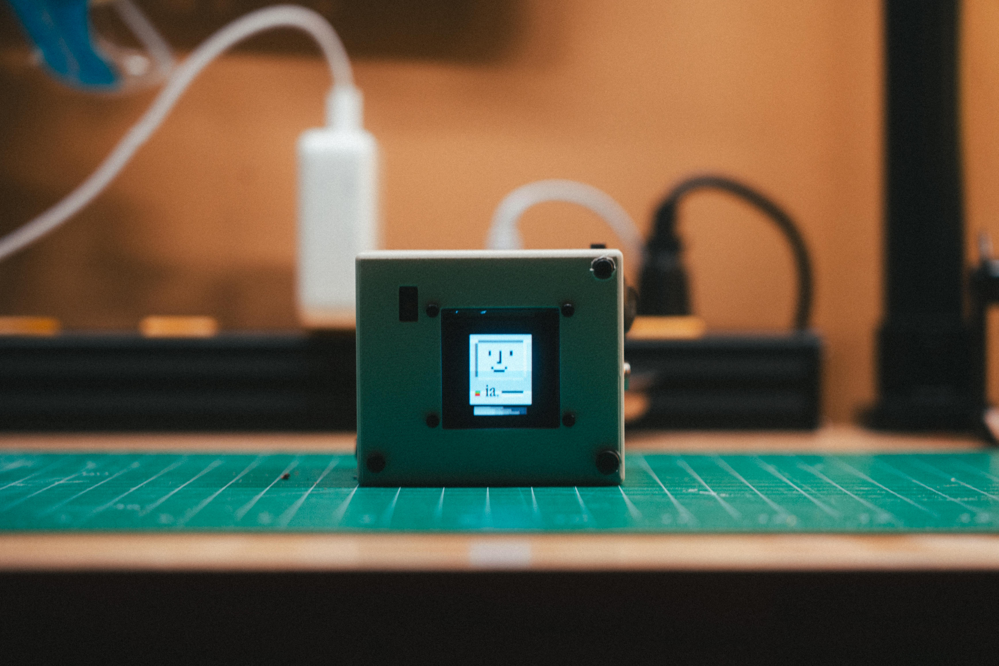
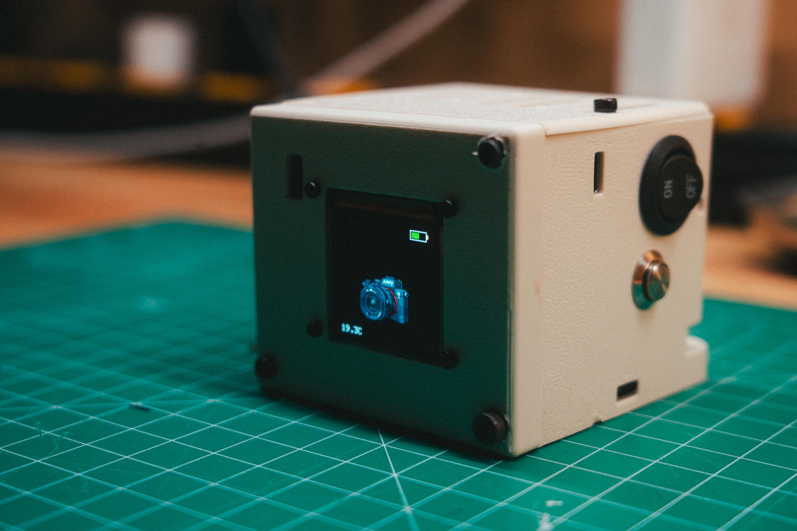
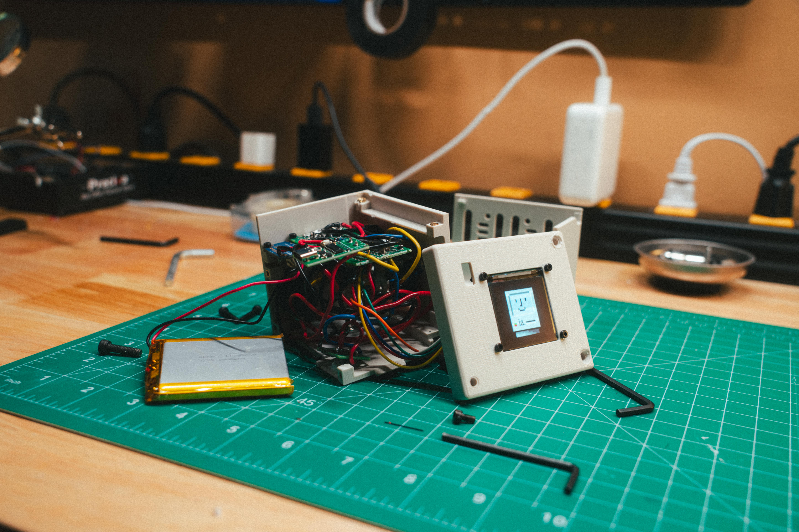
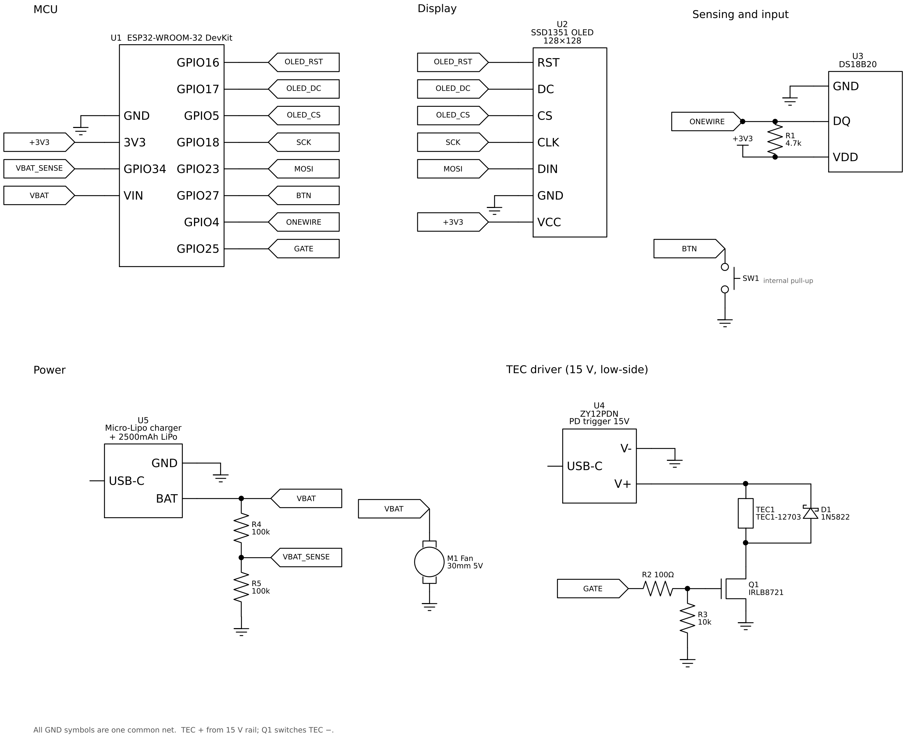

# A7IV-TEC

An active thermoelectric cooler for the Sony A7IV with an animated status screen. It mounts behind the rear display, reads the camera's surface temperature, and drives a Peltier module to pull heat out during long recording sessions.

<p align="center">
  
</p>

<p align="center">
  
  
</p>

Built for desk and documentary-style use, not run-and-gun. The Peltier runs on USB-C PD wall power. The battery only powers the electronics.

## How it works

A DS18B20 sensor sits against the camera body and reports its temperature to an ESP32 twice a second. Above 30°C, the ESP32 PWM-drives a logic-level MOSFET that switches 15V from a USB-C PD board through a Peltier module. Cooling power scales with temperature. A 128×128 OLED shows a character whose animation reflects the camera's thermal state.

<!-- Block diagram image -->

### Thermal stack

From the camera outward:

1. **Copper shim (0.5mm).** A flat contact plate against the camera. No paste touches the camera, so the module detaches cleanly.
2. **Thermal paste.** Internal only, between the shim and the TEC.
3. **TEC1-12703 cold face.** Pumps heat from the shim to the hot face.
4. **TEC hot face, then paste.**
5. **40×40mm heatsink.** Rejects the pumped heat plus the TEC's own electrical input.
6. **30mm fan.** Pushes air through the fins and out of the enclosure, away from the battery.

The temperature sensor sits on its own small copper pad beside the TEC, not on the TEC's shim, so it reads the camera rather than the cooler.

### Control logic

Peltier duty ramps linearly from 0 at 30°C to the cap at 45°C.

| State | Temp range | Animation | Peltier |
|---|---|---|---|
| LOGO / BOOT | startup | Logo zoom, then loading screen | Off |
| COOLED | < 30°C | Static camera | Off |
| NEAR | 30–34°C | Drops, small flames | Low duty |
| COOLING | 34–40°C | Rain cloud over flames | Ramping |
| HOT | > 40°C | Camera on fire | High duty, up to cap |

- **Hysteresis:** each state boundary has a 1.5°C dead band so the animation doesn't flicker at the edges.
- **HOT dwell:** once HOT is entered it holds for at least 6s, so a brief spike still reads as an alert.
- **Duty cap:** `DUTY_MAX = 204` (80%). The PD board supplies 15V but the TEC is a 12V module. 80% duty averages about 12V, and no code path can exceed it.

https://github.com/user-attachments/assets/6ffee958-7b5d-4f13-8549-dd4278680188

## Hardware

### Bill of materials

| Part | Spec | Qty | Approx cost (CAD) | Source |
|---|---|---|---|---|
| ESP32 dev board | ESP32-WROOM-32, CP2102 | 1 | $14 | Amazon |
| OLED display | Waveshare 1.5" SSD1351, 128×128 RGB | 1 | $25 | Amazon |
| Peltier module | TEC1-12703, 40×40mm, 12V | 1 (2-pack) | $15 | Amazon |
| MOSFET | IRLB8721, logic-level, TO-220 | 1 (20-pack) | $6 | AliExpress |
| Temperature sensor | DS18B20, TO-92 | 1 (10-pack) | $7 | AliExpress |
| USB-C PD trigger | ZY12PDN, screw terminals | 1 | $19 | Amazon |
| LiPo battery | 3.7V 2500mAh, JST-PH | 1 | $20 | Adafruit #328 |
| LiPo charger | Adafruit Micro-Lipo, USB-C | 1 | $8 | Adafruit #4410 |
| Fan | 30×30×8mm, 5V 0.2A | 1 | $5 | Adafruit |
| Heatsink | 40×40×11mm aluminium | 1 | $7 | Amazon |
| Copper shims | 40×40×0.5mm | 1 (4-pack) | $15 | Amazon |
| Thermal paste | Any standard paste | 1 | $9 | Amazon |
| Pushbutton | Momentary | 1 | — | — |
| Resistors | 4.7kΩ, 2× 100kΩ, 100Ω, 10kΩ | — | $20 (kit) | Amazon |
| Diode | 1N5822 Schottky | 1 | — | — |
| Perfboard | Double-sided, plated | 1 | — | — |

**Total: roughly $170 CAD**, mostly in packs with spares.

### Tools needed

- Soldering iron and solder
- Multimeter (for continuity checks and battery calibration)
- USB-C PD charger offering 12V or 15V, typically a laptop brick. Phone chargers often stop at 9V.
- Tin snips or scissors for cutting copper

### Wiring
<p align="center">
  
</p>

Schematic:
<p align="center">
  
</p>

| Component | Pin | ESP32 / Rail |
|---|---|---|
| DS18B20 | GND / DQ / VDD | GND / GPIO4 / 3.3V |
| DS18B20 pull-up | 4.7kΩ | DQ ↔ 3.3V |
| OLED | VCC / GND | 3.3V / GND |
| OLED | DIN / CLK / CS / DC / RST | GPIO23 / 18 / 5 / 17 / 16 |
| IRLB8721 gate | via 100Ω | GPIO25 |
| IRLB8721 gate pulldown | 10kΩ | Gate ↔ GND |
| IRLB8721 drain | — | Peltier − |
| IRLB8721 source | — | GND |
| Peltier + | — | PD board 15V out |
| PD board − | — | GND |
| Battery (via Micro-Lipo BAT) | — | ESP32 VIN |
| Battery divider | 100kΩ / 100kΩ | BAT → GPIO34 → GND |
| Button | — | GPIO27 ↔ GND (internal pull-up) |
| 1N5822 | stripe to 15V | Across Peltier |

**Common ground.** The PD board, the battery, the ESP32 and the MOSFET source must all share one ground. Without it the MOSFET has no gate reference and won't switch.

**MOSFET orientation.** With the printed face toward you and legs down, the pins are gate, drain, source. It switches the low side: the Peltier sits between 15V and the drain. The TO-220 tab is the drain, so keep it off anything grounded.

**DS18B20 pinout.** With the flat face toward you and legs down: GND, DQ, VDD. Swapping GND and VDD makes the sensor overheat within seconds.

**Logic-level MOSFET.** Generic "MOSFET trigger modules" usually use an IRF520, which doesn't fully turn on from 3.3V. Use an IRLB8721 or another logic-level part.

## Firmware

### Requirements

- [PlatformIO](https://platformio.org/) (CLI or IDE extension)
- On macOS: the [Silicon Labs CP210x driver](https://www.silabs.com/developer-tools/usb-to-uart-bridge-vcp-drivers). After installing, run the installer app and allow the system extension in Privacy & Security.
- Python 3 and Pillow (`pip install pillow`) for the sprite tool

### Build and flash

```bash
git clone https://github.com/AppleJuiceIzy/sony-a7iv-tec-version1.git
cd sony-a7iv-tec-version1/firmware
pio run --target upload
pio device monitor --baud 115200
```

Set `upload_port` in `platformio.ini` to whatever `ls /dev/cu.*` shows: usually `/dev/cu.SLAB_USBtoUART` or `/dev/cu.usbserial-0001`. If the upload stalls at `Connecting...`, hold BOOT until the write percentages appear, and close any open serial monitor first.

### Configuration

All of these live at the top of `firmware/src/main.cpp`.

| Constant | Default | Purpose |
|---|---|---|
| `DUTY_MAX` | 204 | PWM ceiling (80%). Use 255 only on a true 12V supply. |
| `TEMP_OFF` / `TEMP_FULL` | 30 / 45°C | Duty ramp start and end |
| `T_NEAR` / `T_COOLING` / `T_HOT` | 30 / 34 / 40°C | Animation state thresholds |
| `T_HYST` | 1.5°C | Dead band on each boundary |
| `HOT_DWELL_MS` | 6000 | Minimum time HOT stays on screen |
| `MANUAL_COOL_DUTY` | `DUTY_MAX` | Duty floor during manual cooling |
| `MANUAL_COOL_TIMEOUT_MS` | 600000 | Manual cooling auto-off (10 min) |
| `BATTERY_DIVIDER_RATIO` | 2.064 | Battery calibration (see below) |

**Calibrating the battery reading.** Charge the cell full and measure it with a multimeter. Then run on battery with USB unplugged and note the `Vbat` shown in serial. New ratio = current ratio × measured ÷ reported. Resistor tolerance means every build lands slightly differently.

### Controls

| Input | Action |
|---|---|
| Single press | Toggle stats page |
| Double press | Manual cooling (10 min timeout) |

Single presses register after a 350ms delay, while the firmware waits to rule out a double press.

### Serial commands

| Command | Effect |
|---|---|
| `state 0`–`5` | Force a state: 0 logo, 1 boot, 2 cooled, 3 near, 4 cooling, 5 hot |
| `state auto` | Return to temperature-driven animation |
| `boot` | Replay the startup sequence |
| `page` | Toggle the stats page |
| `cool` | Toggle manual cooling |

## Custom sprites

Frames are 128×128 PNGs, converted to RGB565 arrays in `firmware/src/sprites.h`. Don't edit that file by hand.

1. Draw frames at exactly 128×128. Transparency is composited onto black.
2. Save them in `art/` using the filenames in the `CLIPS` table at the top of `tools/png2sprites.py`.
3. Regenerate the header and upload:

```bash
python3 tools/png2sprites.py art firmware/src/sprites.h
cd firmware && pio run --target upload
```

To add frames or change timing, edit `CLIPS`. Each entry is `(state name, [png files], ms per frame)`. Frame counts are picked up automatically. If a PNG is missing, the script reuses the existing array and prints a warning.

## Repository structure

```
art/        Source sprite PNGs
docs/       BOM, wiring notes, build log
firmware/   PlatformIO project (src/main.cpp, src/sprites.h)
tools/      png2sprites.py sprite converter
```

## License

MIT. See [LICENSE](LICENSE).

Built with [Adafruit GFX](https://github.com/adafruit/Adafruit-GFX-Library), [Adafruit SSD1351](https://github.com/adafruit/Adafruit-SSD1351-library), [OneWire](https://github.com/PaulStoffregen/OneWire) and [DallasTemperature](https://github.com/milesburton/Arduino-Temperature-Control-Library).
